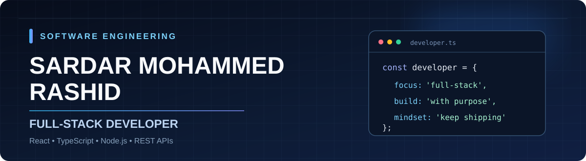

### Full-Stack Developer | React · TypeScript · Node.js

**Building web applications from interface to API — with attention to usability, performance, and the details that make software dependable.**

Based in Kurdistan Region, Iraq · Open to remote full-stack opportunities and international collaboration

---

## Engineering with purpose

I develop full-stack JavaScript applications, working across **responsive React interfaces, Node.js/Express APIs, authentication, and data-driven features**.

My approach is hands-on: **build, test, debug, refine, and ship**. I value clear architecture, readable code, thoughtful user experiences, and a Git history that makes progress easy to follow. I enjoy working through the difficult details—not just getting a feature to appear on the screen, but understanding how its pieces fit together.

I work independently, take ownership of technical problems, and welcome collaboration with teams building useful products.

## Selected work

<table>
<tr>
<td width="50%" valign="top">

### [ShopZone — E-commerce Platform](https://github.com/sardarMrashed/shopzone-ecommerce)

Full-stack shopping experience with product browsing, cart and order flows, and JWT-based authentication.

**React · Node.js · Express · MongoDB**

[Repository](https://github.com/sardarMrashed/shopzone-ecommerce) · [Live demo](https://shopzone-ecommerce-fawn.vercel.app/)

</td>
<td width="50%" valign="top">

### [AI Resume Analyzer](https://github.com/sardarMrashed/resume-analyzer)

Resume analysis workflow combining PDF text extraction, upload validation, and AI-powered feedback via the Groq API.

**JavaScript · API integration · PDF processing**

[Repository](https://github.com/sardarMrashed/resume-analyzer) · [Live demo](https://resume-analyzer-flax-one.vercel.app/)

</td>
</tr>
<tr>
<td width="50%" valign="top">

### [Full-Stack Blog](https://github.com/sardarMrashed/fullstack-blog)

Content application demonstrating create, read, update, and delete workflows across a MERN stack.

**React · Express · MongoDB**

[Repository](https://github.com/sardarMrashed/fullstack-blog) · [Demo](https://fullstack-blog-iota-black.vercel.app/)

</td>
<td width="50%" valign="top">

### [Mobile Shop](https://github.com/sardarMrashed/mobile-shop)

Mobile shopping interface featuring product discovery, an API-backed catalog, and cart interactions.

**React Native · Expo · Node.js**

[Repository](https://github.com/sardarMrashed/mobile-shop)

</td>
</tr>
</table>

## In focus: DataPilot Enterprise

**[DataPilot Enterprise](https://github.com/sardarMrashed/datapilot)** · [Source code & progress](https://github.com/sardarMrashed/datapilot)

A structured full-stack application project, developed with an emphasis on component design, maintainable architecture, and a disciplined Git workflow.

**Current implementation:** React, TypeScript, and Vite frontend scaffold.  
**Architecture roadmap:** Express API, PostgreSQL, automated testing, and deployment.

I use this project to document engineering decisions, develop features in deliberate increments, and strengthen the practices that matter when working on a team.

## Technology stack

**Frontend**  

**Backend & data**  

**Workflow & delivery**  

## How I work

- **Ownership:** See technical problems through from investigation to implementation.
- **Consistency:** Make measurable progress through focused development and iteration.
- **Quality:** Prioritize reusable components, understandable APIs, and careful debugging.
- **Collaboration:** Communicate clearly, document decisions, and work with Git-based workflows.

---

### Let's build something useful.

**Full-stack development · Remote collaboration · Product-focused engineering**

[Portfolio](https://sardar-portfolio.vercel.app/) · [LinkedIn](https://www.linkedin.com/in/sardar-mohammed-rashid/) · [Email](mailto:sardarmohamad96@gmail.com)

